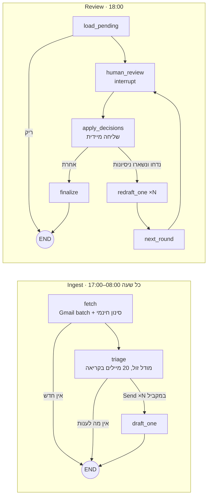

# סוכן מענה למיילים עם אישור יומי (LangGraph)

הסוכן קורא מיילים חדשים מ־Gmail, מסנן את מה שלא צריך מענה, וכותב טיוטות תשובה.
כל יום ב־18:00 קופצת התראה במחשב ונפתח דף שבו מאשרים את כל הטיוטות בבת אחת.

- **טיוטה שאושרה** נשלחת מיד. אם ערכת את הטקסט, נשלח הטקסט הערוך.
- **טיוטה שנדחתה** מקבלת הערה ו/או עריכה ידנית. הסוכן מנסח אותה מחדש, שומר על העריכות שלך, ומציג אותה שוב באותו סבב.
- אחרי 3 ניסיונות הטיוטה מסומנת **לטיפול ידני**.
- טיוטה שלא הוחלט עליה **נשארת למחר**, ולא נספר עליה ניסיון.

## ארכיטקטורה

שני גרפים של LangGraph, ו־SQLite כמקור האמת לסטטוס של כל טיוטה:



איך הפרויקט עומד בדרישות החובה:

| דרישה | איפה |
|---|---|
| LangGraph | `mail_agent/graphs.py` |
| ענף מותנה | `fetch → triage/END`, `triage → draft/END`, `apply → redraft/finalize` |
| לולאה | `human_review → apply → redraft → next_round → human_review`, עד 3 ניסיונות |
| interrupt / human-in-the-loop | `interrupt()` בתוך `human_review`. החידוש נעשה עם `Command(resume=...)` מדף האישור |
| שמירת מצב | `SqliteSaver` (checkpoints) ו־`agent.db` (טיוטות, שימוש בטוקנים) |

## חיסכון בטוקנים, מהירות ודיוק

1. **סינון בלי LLM.** מיילים עם List-Unsubscribe, ‏Precedence: bulk, ‏Auto-Submitted, כתובות no-reply, קטגוריות קידום מכירות/עדכונים, ומיילים ששלחת בעצמך לא מגיעים למודל בכלל.
2. **מיון מרוכז.** עד 20 מיילים בקריאה אחת למודל הזול, עם Structured Outputs. כל מייל נחתך ל־500 תווים, ובמקום מזהי Gmail ארוכים נשלחים מזהים קצרים (1, 2, 3…).
3. **ניקוי טקסט.** לפני הכתיבה מוסרים ציטוטים של מיילים קודמים, שורות `>` וחתימות, והגוף מוגבל ל־2,500 תווים. מההיסטוריה של השרשור נשלחים רק snippets קצרים של שתי ההודעות הקודמות.
4. **ניצול prompt caching.** ה־system prompt והפרופיל זהים בכל הקריאות ומופיעים ראשונים, כך ש־OpenAI יכולה להשתמש שוב ב־prefix. נתוני ה־cache נרשמים בטבלת `usage`.
5. **ניסוח מחדש ממוקד.** בסבב חוזר נשלחים רק תקציר המייל, הטיוטה הנוכחית וההערה. השרשור לא נשלף מחדש.
6. **מקביליות.** כתיבה וניסוח מחדש רצים במקביל דרך `Send`, וקריאת המיילים מ־Gmail נעשית ב־HTTP batch.
7. **דיוק.** המודל לא ממציא תאריכים, מחירים או התחייבויות. במקום מידע חסר הוא כותב `[placeholder]`. תוכן המייל מסומן כנתונים ולא כהוראות, כהגנה מפני prompt injection.
8. **אמינות.** כישלון בטיוטה אחת לא מפיל את כל הריצה; המייל ייקלט שוב בריצה הבאה. השליחה אידמפוטנטית: טיוטה שכבר נשלחה לא תישלח שוב גם אם הריצה חודשה אחרי קריסה.

`python -m mail_agent stats` מציג את צריכת הטוקנים היומית לפי מודל, כולל כמה מהטוקנים נלקחו מה־cache.

## התקנה (Windows)

```powershell
cd mail-agent
py -3.12 -m venv .venv
.venv\Scripts\activate
pip install -r requirements.txt
copy .env.example .env            # למלא GEMINI_API_KEY (או OPENAI_API_KEY) ו-OWNER_NAME
copy profile.example.md profile.md # סגנון כתיבה וחתימה
```

**הרשאת Gmail (פעם אחת):**
1. ב־Google Cloud Console: יוצרים פרויקט, מפעילים את **Gmail API**, ויוצרים OAuth Client מסוג **Desktop app**.
2. שומרים את קובץ ה־JSON בנתיב `data\credentials.json`.
3. מריצים `python -m mail_agent auth`. הדפדפן ייפתח לאישור, ונוצר `data\token.json`.
   ההרשאה היחידה שמתבקשת היא `gmail.modify` (קריאה ושליחה, בלי מחיקה).

**ניסיון בלי Gmail ובלי OpenAI:**
```powershell
python -m mail_agent demo
```
נפתח דף האישור עם שתי טיוטות לדוגמה. מייל הניוזלטר מסונן בלי LLM, ומייל ה"תודה" מסווג כלא צריך מענה.

**תזמון:**
```powershell
powershell -ExecutionPolicy Bypass -File scripts\install_tasks.ps1
Start-ScheduledTask -TaskName MailAgent-Review   # בדיקה מיידית
```
- `MailAgent-Ingest` רץ כל שעה מ־08:00 עד 17:00, בשקט.
- `MailAgent-Review` רץ ב־18:00: מבצע איסוף אחרון, ואז מציג התראת Windows ופותח את דף האישור.
- אם המחשב היה כבוי ב־18:00, המשימה תרוץ כשתתחבר.

## דף האישור

- רץ על `127.0.0.1` בלבד, עם token חד־פעמי בכתובת.
- לכל טיוטה בוחרים אחת משלוש אפשרויות: **אשר ושלח**, **דחה עם הערה** או **השאר למחר**. את הטקסט אפשר לערוך בכל אחת מהן.
- כדי לדחות צריך הערה או עריכה. אם ערכת ולא כתבת הערה, הסוכן ילטש את הנוסח שלך.
- אחרי "שלח החלטות": מה שאושר נשלח, מה שנדחה מנוסח מחדש, והטיוטות החדשות מוצגות מיד בסבב הבא.
- אם לא עונים תוך 5 שעות (`REVIEW_TIMEOUT_MIN`), הדף נסגר וכל מה שלא הוחלט עליו עובר למחר. `python -m mail_agent review --resume` ממשיך סבב שנקטע.

## מבנה הקבצים

```
mail_agent/
  graphs.py         שני הגרפים (הליבה)
  llm.py, prompts.py  קריאות ל-OpenAI: מיון מרוכז, כתיבה, ניסוח מחדש
  gmail_client.py   Gmail API: batch fetch, שליחה בתוך השרשור
  text_utils.py     ניקוי ציטוטים, HTML→טקסט, סינון אוטומטי
  db.py             SQLite: טיוטות, מיילים שטופלו, צריכת טוקנים
  review_server.py, review.html  דף האישור והחיבור ל-interrupt
  notify.py         התראת Windows
  fakes.py          Gmail ו-LLM מדומים לדמו ולבדיקות
scripts/install_tasks.ps1
tests/
```

בדיקות: `python -m unittest discover -s tests -t .`

## מגבלות ידועות

- התשובה נשלחת רק לשולח (או ל־Reply-To), בלי Reply-all, כטקסט פשוט.
- הסוכן לא שולח קבצים מצורפים. אם צריך, הוא כותב placeholder.
- מודלים ברירת מחדל: `gemini-flash-lite-latest` למיון ו־`gemini-flash-latest` לכתיבה (אם הוא עמוס, נוסים לפי הסדר המודלים שב־`DRAFT_FALLBACKS`; מודלי Lite משמשים רק מהשעה `LITE_AFTER_HOUR`, ולפני כן הטיוטה נדחית לריצה הבאה). אפשר להחליף ב־`.env`, גם למודלי `gpt-*` של OpenAI. גם מודלי reasoning נתמכים: במקרה כזה לא נשלח `temperature`.

## פרטיות, תנאים ורישיון

- [מדיניות פרטיות](https://lali507.github.io/mail-agent/privacy.html) · [תנאי שימוש](https://lali507.github.io/mail-agent/terms.html)
- קוד פתוח ברישיון [MIT](LICENSE).

> 🤖 **נבנה בעזרת [Claude](https://claude.com/claude-code)**, מודל הבינה המלאכותית של Anthropic. Anthropic אינה מפעילה את האפליקציה ואינה מקבלת את המידע שלה.
